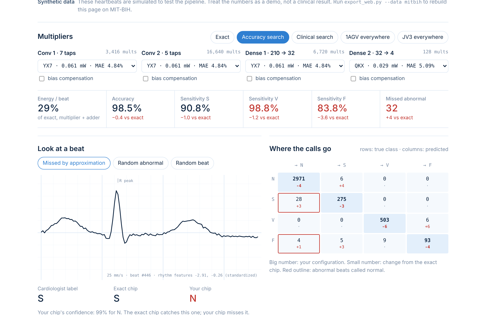
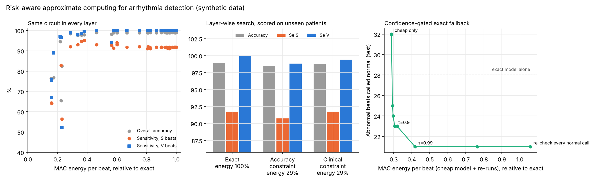
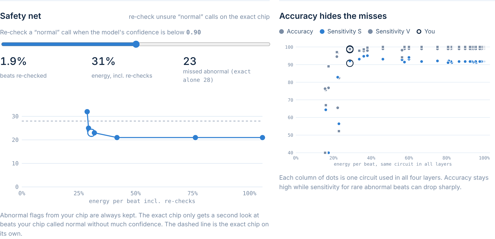

# Risk-aware approximate computing for wearable heart monitoring

When a wearable heart monitor saves energy with approximate arithmetic, **which heartbeats does
it start to miss?** Overall accuracy hides the answer, because abnormal beats are rare. This
project measures it directly and adds two fixes.

This is my personal research project. It grew out of my CECS 530 group project on approximate
computing, [approx-computing-ml](https://github.com/vohongvyle/approx-computing-ml), where we judged
designs by overall accuracy on handwritten digits. I wanted to know what that hides in health
monitoring: which heartbeats a wearable device starts to miss when it saves energy. Everything is
plain NumPy, so it runs on a laptop.

**▶ Live demo: [vohongvyle.github.io/heartbeat-approx-research](https://vohongvyle.github.io/heartbeat-approx-research/)**



*The interactive page that comes with the project. Pick an approximate multiplier for each layer;
the 8-bit network runs on every test beat in the browser and reports energy, accuracy,
sensitivity for each class and abnormal beats missed.*

## The problem

A heartbeat classifier sorts each beat into the AAMI classes: N (normal), S (supraventricular),
V (ventricular) and F (fusion). About three in four test beats are normal, so a design can lose
many abnormal beats while its overall accuracy barely moves.


## What it does

- A small 1D CNN classifies each beat from 0.7 s of ECG around the R peak, plus two rhythm
  features (how early the beat came, how long the pause after it was).
- The network runs in 8 bits, and each of its ~27,000 multiplications per beat goes through the
  lookup table of one of 36 approximate multipliers from
  [EvoApproxLib](https://github.com/ehw-fit/evoapproxlib).
- Patients are split between training and testing, so the model is always tested on people it
  has not seen.
- For each design it reports accuracy, sensitivity for each class and the number of abnormal
  beats called normal.

Two additions:

1. **A clinically constrained search.** It picks a multiplier for each layer while keeping
   S and V sensitivity close to the exact design, instead of watching overall accuracy only.
2. **A confidence-gated fallback.** A beat the approximate model calls "normal" with low
   confidence is re-checked on the exact multiplier. Abnormal calls are never overruled.


*Left: a supraventricular beat that the exact multiplier classifies correctly and the cheap one
calls normal. Right: where every test beat's call goes; red boxes are abnormal beats called
normal, and the small numbers show the change from the exact design.*

## Results so far (simulated heartbeats)

These come from a synthetic test bench used to validate the pipeline. They are not clinical
results; the MIT-BIH run is next.



- **Accuracy does not rank designs by risk.** One multiplier kept 82% accuracy but missed 111
  abnormal beats, against 28 for the exact design. Another lost more accuracy yet missed only 9.
- **The fallback beats the exact model.** It re-checks 1.9% of beats, uses 31% of the exact
  design's arithmetic energy, and misses 23 abnormal beats, fewer than the exact model alone.



*Left: move the threshold to trade energy for fewer missed beats. Right: for each multiplier,
accuracy (grey) stays high while sensitivity for rare beats can drop sharply.*

## Run it

```bash
pip install -r requirements.txt
git clone https://github.com/ehw-fit/evoapproxlib
python3 build_luts.py --lib evoapproxlib --out luts    # multiplier lookup tables (needs a C compiler)

python3 ecg/ecg_experiment.py                  # synthetic heartbeats, about 5 minutes
python3 ecg/export_web.py                      # rewrites docs/data.js; open docs/index.html

python3 ecg/mitbih.py                          # downloads MIT-BIH (~100 MB), prints beat counts
python3 ecg/ecg_experiment.py --data mitbih    # real data
python3 ecg/export_web.py --data mitbih
```

Options: `--acc-budget 0.5` (allowed drop in overall accuracy, points), `--se-budget 1.0`
(allowed drop in S and V sensitivity, points), `--seed`, `--epochs`.

## Files

| File | What it does |
|---|---|
| `build_luts.py` | Builds a 256×256 lookup table for each EvoApproxLib 8×8 multiplier |
| `ecg/synth_ecg.py` | Synthetic heartbeats from simulated patients, for testing without downloads |
| `ecg/mitbih.py` | Loads MIT-BIH: lead MLII, AAMI classes, DS1/DS2 patient split |
| `ecg/cnn.py` | 1D CNN trained in NumPy, its 8-bit approximate version, bias compensation |
| `ecg/ecg_experiment.py` | Multiplier sweep, layer-wise searches, gated fallback, summary figure |
| `ecg/export_web.py` | Writes the results into `docs/data.js` for the web page |
| `docs/index.html`, `style.css`, `app.js` | The interactive web page (served by GitHub Pages) |
| `docs/data.js` | Model, test beats and multiplier tables used by the page |
| `docs/images/` | Figures and screenshots used in this README |

## Web page on GitHub Pages

The page in `docs/` runs the 8-bit network in the browser, so it needs no server. To publish it:
*Settings → Pages → Build and deployment → Deploy from a branch → `main` / `/docs` → Save*.
After a minute it is live at `https://vohongvyle.github.io/heartbeat-approx-research/`.

## Limitations

- Results so far are on simulated beats, which are cleaner than real ECG.
- Energy counts the multiplier and accumulator adder only (45 nm figures), not memory, sensing or radio.
- One small CNN, post-training approximation only.

## References

- V. Mrazek et al., "EvoApprox8b: Library of approximate adders and multipliers for circuit design and benchmarking of approximation methods," DATE 2017.
- P. de Chazal, M. O'Dwyer, R. B. Reilly, "Automatic classification of heartbeats using ECG morphology and heartbeat interval features," IEEE TBME, 2004.
- G. B. Moody, R. G. Mark, "The impact of the MIT-BIH Arrhythmia Database," IEEE EMB Magazine, 2001.
- F. Bulten et al., "Toward Energy-Efficient and Low-Power Arrhythmia Detection for Wearable Devices," arXiv:2607.14747, 2026.
