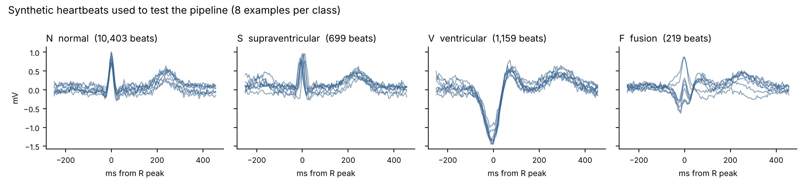
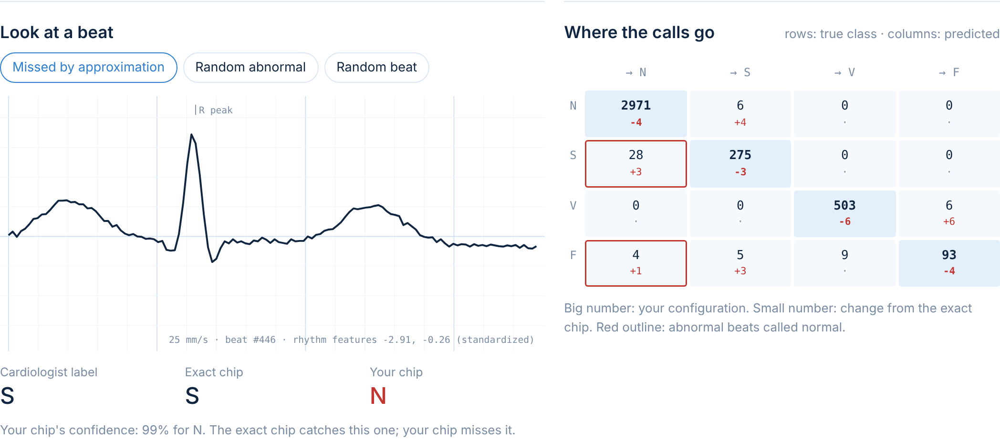

## Risk-Aware Approximate Computing for Heartbeat Monitoring

I built this project to measure that risk and try two ways to reduce when a wearable heart monitor saves energy by using approximate arithmetic, which heartbeats might it miss and so overall accuracy can hide the answer because abnormal beats are rare. . This personal research project grew out of my CECS 530 group project on approximate computing, [approx-computing-ml](https://github.com/vohongvyle/energy-approxcomputing-cecs530). In that project, we compared designs using overall accuracy on handwritten digits. I wanted to see what that measure might hide in health monitoring: which heartbeats a wearable device could miss while saving energy. I wrote the project in NumPy so it can run on a laptop.

## About the code

The classifier sorts each heartbeat into one of four AAMI classes: N (normal), S (supraventricular), V (ventricular), or F (fusion). About three in four test beats are normal, so a design can miss many abnormal beats while its overall accuracy barely changes.

- A small 1D CNN that classifies each beat using 0.7 seconds of ECG around the R peak, along with two rhythm features: how early the beat came and how long the pause after it was.
- An 8-bit version of the network. For each beat, about 27,000 multiplications use a lookup table for one of 36 approximate multipliers from [EvoApproxLib](https://github.com/ehw-fit/evoapproxlib).
- A patient-based training and testing split, so the model is evaluated on people it has not seen during training.
- Reports for accuracy, sensitivity for each class, and the number of abnormal beats classified as normal.

I also added two ways to reduce risk:

1. Clinically constrained search I search for a multiplier for each layer while keeping S and V sensitivity close to the exact design, rather than choosing designs based only on overall accuracy.
2. Confidence-gated fallback When the approximate model predicts “normal” with low confidence, I check that beat again using the exact multiplier. The fallback never overrules an abnormal prediction.

*On the left, a supraventricular beat that the exact multiplier classifies correctly is called normal by the approximate one. On the right, the chart shows where each test beat was classified. Red boxes mark abnormal beats called normal; the small numbers show the change from the exact design.*

## Limitations

- So far, I have tested the pipeline on simulated beats, which are cleaner than real ECG data.
- My energy estimate counts only the multiplier and accumulator adder, using 45 nm figures. It does not include memory, sensing, or radio energy.
- I used one small CNN and applied approximation after training.

## References

- V. Mrazek et al., “EvoApprox8b: Library of approximate adders and multipliers for circuit design and benchmarking of approximation methods,” DATE 2017.
- P. de Chazal, M. O'Dwyer, R. B. Reilly, “Automatic classification of heartbeats using ECG morphology and heartbeat interval features,” IEEE TBME, 2004.
- G. B. Moody, R. G. Mark, “The impact of the MIT-BIH Arrhythmia Database,” IEEE EMB Magazine, 2001.
- F. Bulten et al., “Toward Energy-Efficient and Low-Power Arrhythmia Detection for Wearable Devices,” arXiv:2607.14747, 2026.
